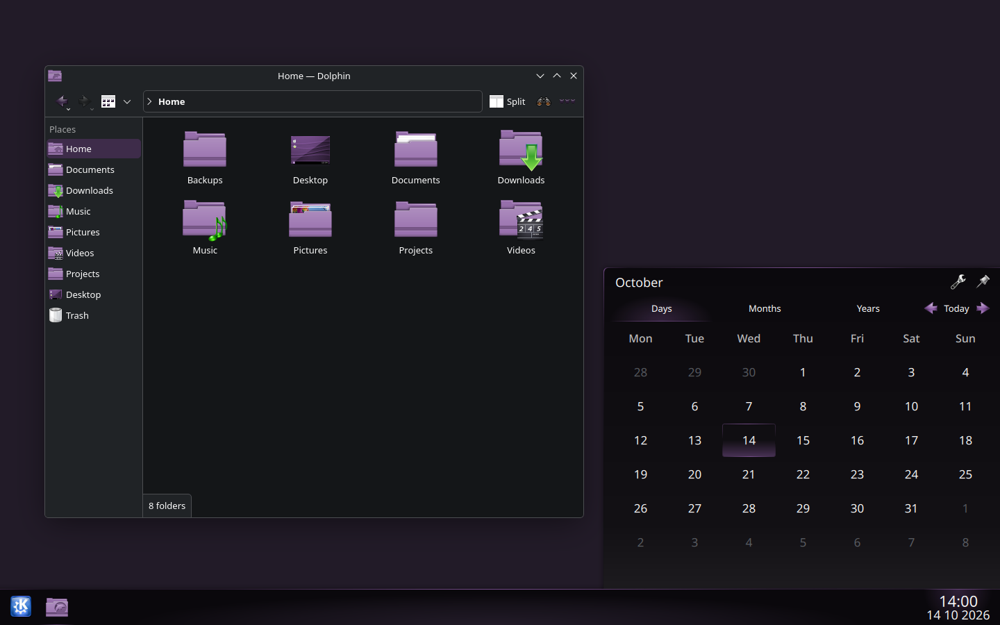
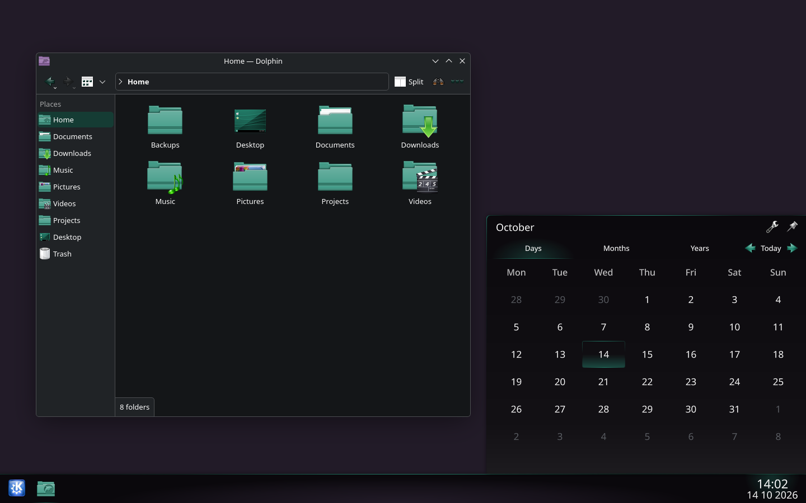

# Oxygen Accent

Oxygen Accent makes Oxygen's Plasma lighting and blue icon details follow your KDE accent color. Both appear as **Oxygen Accent** in System Settings. The original Oxygen themes stay untouched.

The icon theme inherits unchanged icons from Oxygen. Application logos, named folder colors, and colored status badges keep their original colors.

## What this fork adds

This comparison uses Oxygen 6.8.0 and Oxygen Icons 6.31.

| Component | Upstream support | Oxygen Accent |
| --- | --- | --- |
| Window decorations | Active-window glows follow the accent color by default. | Uses the upstream Oxygen decoration. |
| Plasma style | Some controls use palette colors, but panel and task glows still have fixed white gradients. | Makes decorative lighting, glows, and gradients follow the system highlight color. |
| Icons | Default folders and many interface symbols keep their original blue. | Makes folders, Dolphin, navigation arrows, and standard toolbar symbols follow the accent color. |

See upstream's [window-glow settings](https://invent.kde.org/plasma/oxygen/-/blob/v6.8.0/liboxygen/oxygenactiveshadowconfigdata.kcfg) and [panel artwork](https://invent.kde.org/plasma/oxygen/-/blob/v6.8.0/desktoptheme/oxygen/widgets/panel-background.svg). Upstream tracks folder accent support in [bug #523683](https://bugs.kde.org/show_bug.cgi?id=523683).

## Install

You need KDE Plasma 6.8 or newer and the Oxygen icon pack. On Arch Linux, install the `oxygen-icons` package if you don't have it.

Download the Plasma style or icon archive from [the latest release](https://github.com/D3SOX/oxygen-accent/releases/latest). Use **Install from File** under Plasma Style or Icons in System Settings.

KDE Store listings: [Plasma style](https://store.kde.org/p/2378747) and [icons](https://store.kde.org/p/2378748).

To install both from source:

```sh
git clone https://github.com/D3SOX/oxygen-accent.git
cd oxygen-accent
./install.sh
```

The installer uses `~/.local/share`, or `$XDG_DATA_HOME` if set. It backs up any existing Oxygen Accent copies and prints the backup path. To update an existing installation, run `git pull --ff-only` and `./install.sh` again.

In System Settings:

1. Select **Oxygen Accent** under **Plasma Style**.
2. Select **Oxygen Accent** under **Icons**.
3. Choose your accent color under **Colors**.

You can use either theme on its own. If an app keeps its old icons, close and reopen it. If the panel keeps its old icons, log out and back in.

## Screenshots

Purple accent with Dolphin and the Plasma calendar.



Green accent with the same themes.



The screenshots also use Oxygen's application style and window decorations. To match them, select Oxygen under Application Style and Window Decorations. On Arch Linux, the `oxygen` package provides these components.

The screenshots use example folders in a hidden virtual Plasma session with a separate profile.

## Releases

Versions use the Oxygen release followed by a fork revision. For example, `6.8.0-1` is the first fork release based on Oxygen 6.8.0.

Update `KPlugin.Version` in `plasma/oxygen-accent/metadata.json`, commit the changes, then create and push the matching signed tag:

```sh
git tag -s v6.8.0-1 -m 'Oxygen Accent 6.8.0-1'
git push origin v6.8.0-1
```

GitHub Actions packages both themes and publishes the release after both archives upload. `./package.sh` creates the same archives locally in `dist/`. The archives include license texts and copyright notices.

KDE Store updates are manual. After publishing a GitHub release:

1. Edit each Store listing and choose **Add URL** under **Files**. Copy the archive's download URL from that GitHub release. It must contain the version tag, such as `/releases/download/v6.8.0-1/`.
2. Set the file version. Choose **Plasma 6** for the Plasma style or **KDE Plasma** for the icons.
3. Update the listing's version and changelog, then save. Keep older file entries linked to their original releases.

You can also run the Release workflow manually with an existing tag. The workflow does not need Store login credentials.

## Remove

Switch to another Plasma style and icon theme, then delete the two installed copies:

```sh
data_dir="${XDG_DATA_HOME:-$HOME/.local/share}"
rm -rf -- "$data_dir/plasma/desktoptheme/oxygen-accent" "$data_dir/icons/oxygen-accent"
```

## Credits and licenses

The Oxygen Project and KDE created the original artwork. D3SOX added the accent support.

The Plasma artwork comes from [Oxygen](https://invent.kde.org/plasma/oxygen/-/tree/v6.8.0/desktoptheme/oxygen) 6.8.0 and uses GPL-3.0-or-later.

The icons use LGPL-3.0-or-later. They use raster artwork from Oxygen Icons 6.31 and [upstream SVG sources](https://github.com/KDE/oxygen-icons/tree/e8f611eff071966bc3522c355673b380d525e5ba/scalable).

The scripts use the MIT license. See [LICENSES](LICENSES) and [REUSE.toml](REUSE.toml) for the license texts and artwork credits.
